<!--
  Every image below is generated by generate_portfolio.py from the portfolio's own fonts, colours and copy,
  in a dark and a light version that GitHub picks from the visitor's theme. Rebuilt daily by
  .github/workflows/generate-svgs.yml, which also refreshes the GitHub contribution graph.
-->

<a href="https://kasif-portfolio.netlify.app">
  <picture>
    <source media="(prefers-color-scheme: dark)" srcset="https://raw.githubusercontent.com/MdKasif0/MdKasif0/main/assets/hero-dark.svg">
    
  </picture>
</a>

  <b><a href="https://kasif-portfolio.netlify.app">Portfolio</a></b> ·
  <b><a href="https://kasif-portfolio.netlify.app/reel/kasif-reel-1080.mp4">Showreel</a></b> ·
  <b><a href="https://x.com/md_kasif_uddin">X</a></b> ·
  <b><a href="mailto:mdkasifuddin123@gmail.com">Email</a></b> ·
  <b><a href="https://kasif-portfolio.netlify.app/cv.pdf">CV</a></b>

<!-- 01 / SELECTED WORK -->
<a href="https://kasif-portfolio.netlify.app/#work">
  <picture>
    <source media="(prefers-color-scheme: dark)" srcset="https://raw.githubusercontent.com/MdKasif0/MdKasif0/main/assets/work-dark.svg">
    
  </picture>
</a>

  <a href="https://gitroasted.netlify.app"><picture><source media="(prefers-color-scheme: dark)" srcset="https://raw.githubusercontent.com/MdKasif0/MdKasif0/main/assets/project-01-dark.svg"></picture></a>
  <a href="https://cookie-v1.netlify.app/"><picture><source media="(prefers-color-scheme: dark)" srcset="https://raw.githubusercontent.com/MdKasif0/MdKasif0/main/assets/project-02-dark.svg"></picture></a>
  <a href="https://shadow-of-the-crimson-gate.netlify.app/"><picture><source media="(prefers-color-scheme: dark)" srcset="https://raw.githubusercontent.com/MdKasif0/MdKasif0/main/assets/project-03-dark.svg"></picture></a>
  <a href="https://github.com/MdKasif0/black-hole-blender"><picture><source media="(prefers-color-scheme: dark)" srcset="https://raw.githubusercontent.com/MdKasif0/MdKasif0/main/assets/project-04-dark.svg"></picture></a>
  <a href="https://github.com/MdKasif0/AI-Checkers-Arena"><picture><source media="(prefers-color-scheme: dark)" srcset="https://raw.githubusercontent.com/MdKasif0/MdKasif0/main/assets/project-05-dark.svg"></picture></a>
  <a href="https://github.com/MdKasif0/Object-Detection"><picture><source media="(prefers-color-scheme: dark)" srcset="https://raw.githubusercontent.com/MdKasif0/MdKasif0/main/assets/project-06-dark.svg"></picture></a>

<!-- BRAND COLLABORATIONS -->
<a href="https://kasif-portfolio.netlify.app/#recognition">
  <picture>
    <source media="(prefers-color-scheme: dark)" srcset="https://raw.githubusercontent.com/MdKasif0/MdKasif0/main/assets/collabs-dark.svg">
    
  </picture>
</a>

<!-- RECOGNITION -->
<a href="https://kasif-portfolio.netlify.app/certificates/innosprint-2-0.pdf">
  <picture>
    <source media="(prefers-color-scheme: dark)" srcset="https://raw.githubusercontent.com/MdKasif0/MdKasif0/main/assets/recognition-dark.svg">
    
  </picture>
</a>

<!-- 02 / HOW I BUILD -->
<a href="https://kasif-portfolio.netlify.app/#about">
  <picture>
    <source media="(prefers-color-scheme: dark)" srcset="https://raw.githubusercontent.com/MdKasif0/MdKasif0/main/assets/about-dark.svg">
    
  </picture>
</a>

<!-- 03 / THE JOURNEY -->
<a href="https://kasif-portfolio.netlify.app/#journey">
  <picture>
    <source media="(prefers-color-scheme: dark)" srcset="https://raw.githubusercontent.com/MdKasif0/MdKasif0/main/assets/journey-dark.svg">
    
  </picture>
</a>

<!-- 04 / WHAT I BUILD -->
<a href="https://kasif-portfolio.netlify.app/#services">
  <picture>
    <source media="(prefers-color-scheme: dark)" srcset="https://raw.githubusercontent.com/MdKasif0/MdKasif0/main/assets/services-dark.svg">
    
  </picture>
</a>

<!-- BUILDING IN PUBLIC + GITHUB ACTIVITY -->
<a href="https://x.com/md_kasif_uddin">
  <picture>
    <source media="(prefers-color-scheme: dark)" srcset="https://raw.githubusercontent.com/MdKasif0/MdKasif0/main/assets/proof-dark.svg">
    
  </picture>
</a>

<!-- 05 / YOUR NEXT BUILD -->
<a href="https://kasif-portfolio.netlify.app/#contact">
  <picture>
    <source media="(prefers-color-scheme: dark)" srcset="https://raw.githubusercontent.com/MdKasif0/MdKasif0/main/assets/contact-dark.svg">
    
  </picture>
</a>

  <a href="https://kasif-portfolio.netlify.app"><picture><source media="(prefers-color-scheme: dark)" srcset="https://raw.githubusercontent.com/MdKasif0/MdKasif0/main/assets/btn-portfolio-dark.svg"></picture></a>
  <a href="https://kasif-portfolio.netlify.app/reel/kasif-reel-1080.mp4"><picture><source media="(prefers-color-scheme: dark)" srcset="https://raw.githubusercontent.com/MdKasif0/MdKasif0/main/assets/btn-reel-dark.svg"></picture></a>
  <a href="mailto:mdkasifuddin123@gmail.com"><picture><source media="(prefers-color-scheme: dark)" srcset="https://raw.githubusercontent.com/MdKasif0/MdKasif0/main/assets/btn-email-dark.svg"></picture></a>
  <a href="https://x.com/md_kasif_uddin"><picture><source media="(prefers-color-scheme: dark)" srcset="https://raw.githubusercontent.com/MdKasif0/MdKasif0/main/assets/btn-x-dark.svg"></picture></a>

  <a href="https://buymeacoffee.com/mdkasif">Buy me a coffee</a> ·
  

