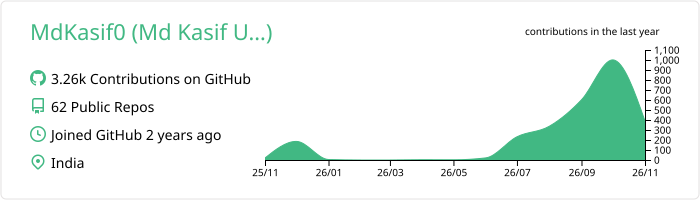
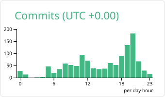

<!-- ===== HERO ===== -->
<!-- GitHub automatically selects the emerald dark or light hero. -->

<picture>
  <source media="(prefers-color-scheme: dark)" srcset="https://raw.githubusercontent.com/MdKasif0/MdKasif0/main/dark.svg">
  <source media="(prefers-color-scheme: light)" srcset="https://raw.githubusercontent.com/MdKasif0/MdKasif0/main/light.svg">
  
</picture>

## 👋 About Me

Hi, I'm **Md Kasif Uddin**, an AI-first developer from Bihar, India, studying at Chandigarh University.
I build full-stack web apps with **TypeScript, React and Next.js**, and I like mixing AI and physics into the things I make, like black-hole simulations and AI-powered games.

- 🔭 Currently building **[GitRoasted](https://github.com/MdKasif0/GitRoasted)**, which analyzes, roasts and ranks GitHub profiles
- 🌱 Always building, learning and shipping
- 📫 Reach me on [X](https://twitter.com/md_kasif_uddin) or by [email](mailto:mdkasifuddin123@gmail.com)

<!-- ===== PROJECTS ===== -->

## 🚀 Featured Projects

<picture>
  <source media="(prefers-color-scheme: dark)" srcset="https://raw.githubusercontent.com/MdKasif0/MdKasif0/main/projects-dark.svg">
  <source media="(prefers-color-scheme: light)" srcset="https://raw.githubusercontent.com/MdKasif0/MdKasif0/main/projects-light.svg">
  
</picture>

**[GitRoasted](https://github.com/MdKasif0/GitRoasted)** ·
**[BlackHole Blender](https://github.com/MdKasif0/black-hole-blender)** ·
**[AI Checkers Arena](https://github.com/MdKasif0/AI-Checkers-Arena)** ·
**[BH Lensing](https://github.com/MdKasif0/Black-Hole-Gravitational-Lensing)** ·
**[Barakah](https://github.com/MdKasif0/Barakah)** ·
**[ReadOn](https://github.com/MdKasif0/ReadOn)**

<!-- ===== GITHUB ACTIVITY ===== -->

## 📈 GitHub Activity

<!-- Streak (full width) -->
<picture>
  <source media="(prefers-color-scheme: dark)" srcset="https://streak-stats.demolab.com/?user=MdKasif0&hide_border=true&background=0A0A0A&stroke=10B981&ring=10B981&fire=FF0000&currStreakLabel=F8FAFC&sideLabels=94A3B8&currStreakNum=F8FAFC&sideNums=F8FAFC&dates=94A3B8&title_color=10B981&card_width=1180" />
  
</picture>

 

<!-- Stats + Top languages (side by side) -->
<picture>
  <source media="(prefers-color-scheme: dark)" srcset="https://github-readme-stats-sigma-rosy-28.vercel.app/api?username=MdKasif0&show_icons=true&count_private=true&include_all_commits=true&hide_rank=true&hide_border=true&title_color=10B981&icon_color=10B981&text_color=F8FAFC&bg_color=0A0A0A&card_width=500" />
  
</picture>
<picture>
  <source media="(prefers-color-scheme: dark)" srcset="https://github-readme-stats-sigma-rosy-28.vercel.app/api/top-langs/?username=MdKasif0&layout=compact&langs_count=8&hide_border=true&title_color=10B981&text_color=F8FAFC&bg_color=0A0A0A&card_width=500" />
  
</picture>

 

<!-- Contribution graph + commit times (generated daily by .github/workflows/profile-summary-cards.yml) -->
<picture>
  <source media="(prefers-color-scheme: dark)" srcset="https://raw.githubusercontent.com/MdKasif0/MdKasif0/main/profile-summary-card-output/gotham/0-profile-details.svg" />
  
</picture>
<picture>
  <source media="(prefers-color-scheme: dark)" srcset="https://raw.githubusercontent.com/MdKasif0/MdKasif0/main/profile-summary-card-output/gotham/4-productive-time.svg" />
  
</picture>

 

<!-- Contribution snake (generated daily by .github/workflows/snake.yml) -->
<picture>
  <source media="(prefers-color-scheme: dark)" srcset="https://raw.githubusercontent.com/MdKasif0/MdKasif0/output/snake-dark.svg" />
  <source media="(prefers-color-scheme: light)" srcset="https://raw.githubusercontent.com/MdKasif0/MdKasif0/output/snake-light.svg" />
  
</picture>

<!-- ===== TECH STACK ===== -->

## 🛠️ Tech Stack

<table>
<tr>
<td align="center" width="33%">

**Languages & Frameworks**

</td>
<td align="center" width="33%">

**AI & Machine Learning**

</td>
<td align="center" width="33%">

**Backend & Database**

</td>
</tr>
<tr>
<td align="center" colspan="3">

**Tools & Platforms**

</td>
</tr>
</table>

<!-- ===== CONNECT ===== -->

## 🤝 Connect

&nbsp;&nbsp;

&nbsp;&nbsp;

&nbsp;&nbsp;

  

