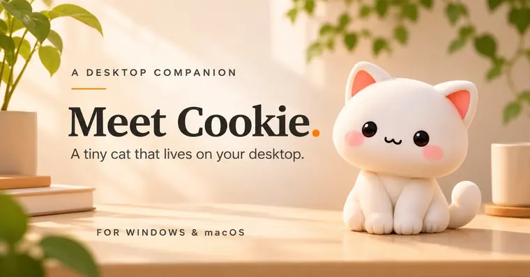
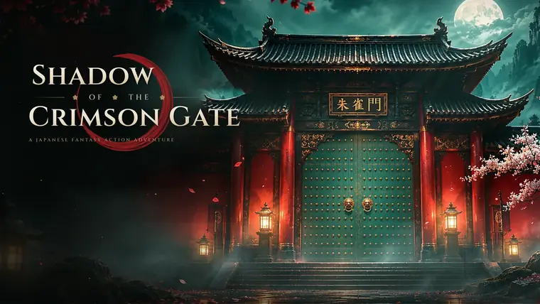
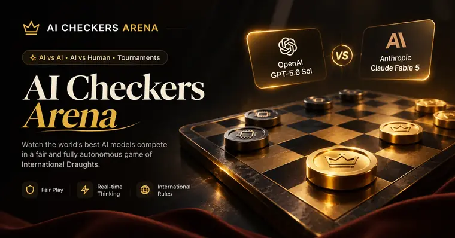
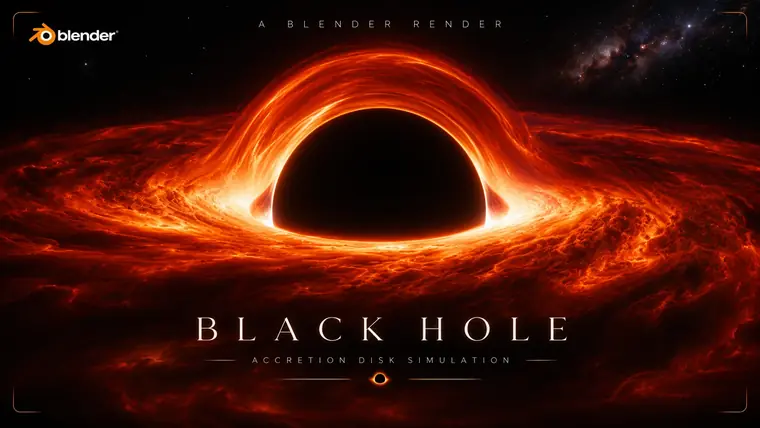
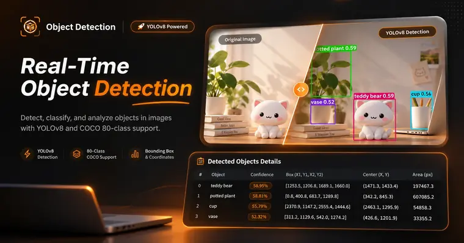

<!-- Header, tech stack, activity chart, logo strip and footer are built by generate_readme_svgs.py and refreshed daily by .github/workflows/generate-svgs.yml -->

<a href="https://kasif-portfolio.netlify.app">
  <picture>
    <source media="(prefers-color-scheme: dark)" srcset="https://raw.githubusercontent.com/MdKasif0/MdKasif0/main/assets/banner-dark.svg">
    
  </picture>
</a>

<p align="center">
  <a href="https://kasif-portfolio.netlify.app"></a>
  <a href="https://x.com/md_kasif_uddin"></a>
  <a href="https://github.com/MdKasif0?tab=followers"></a>
  <a href="https://github.com/MdKasif0?tab=repositories"></a>
  
</p>

## 👋 About me

I'm an AI software engineer and backend architect from India. I take ideas from a rough sketch to a product people can use: the LLM pipeline, the APIs and data model behind it, and an interface that holds up in production. Outside the web I ship native macOS apps and real-time 3D in the browser.

- 🔭 **Building** [GitRoasted](https://gitroasted.netlify.app), which scores any GitHub profile out of 1,000 and lets an AI roast it
- 🏆 **1st Runner-Up** at InnoSprint 2.0 (D4 Community × Google for Developers) with GigSense
- 🎓 **B.Tech CSE** at Chandigarh University, first year
- 📣 **Building in public** on [X](https://x.com/md_kasif_uddin) for 6,500+ followers, with 20+ AI and dev-tool brand collaborations
- 💼 **Open to freelance work:** AI product MVPs, backend and API builds, and AI features for existing apps
- ⚡ **Fun fact:** I write Python so AI can replace me faster

```ts
const kasif = {
  role: ["AI Software Engineer", "Backend Architect", "Tech Creator"],
  basedIn: "India",
  building: ["LLM pipelines", "APIs & data models", "native macOS apps", "3D on the web"],
  currentlyShipping: "GitRoasted",
  openTo: ["freelance", "collaborations", "hackathons"],
  motto: "Fast to ship. Built to hold.",
};
```

## 🚀 Featured projects

<table>
  <tr>
    <td width="50%" valign="top">
      <a href="https://gitroasted.netlify.app"></a>
      <h3><a href="https://gitroasted.netlify.app">GitRoasted</a> 🔥</h3>
      <p>Reads real git activity, scores a GitHub profile out of 1,000 and delivers an unfiltered AI roast, with shareable result cards, a leaderboard and an installable PWA.</p>
      <p><code>Next.js</code> <code>TypeScript</code> <code>Groq</code> <code>Firebase</code></p>
      <p><a href="https://gitroasted.netlify.app"><b>Live</b></a> · <a href="https://github.com/MdKasif0/GitRoasted"><b>Code</b></a></p>
    </td>
    <td width="50%" valign="top">
      <a href="https://cookie-v1.netlify.app/"></a>
      <h3><a href="https://cookie-v1.netlify.app/">Cookie</a> 🐱</h3>
      <p>A tiny, fully offline desktop cat for macOS and Windows. She roams your windows and Dock with real physics, follows your cursor and uses almost no idle CPU.</p>
      <p><code>Swift</code> <code>SwiftUI</code> <code>SpriteKit</code> <code>Sparkle</code></p>
      <p><a href="https://cookie-v1.netlify.app/"><b>Live</b></a> · <a href="https://github.com/MdKasif0/Cookie"><b>Code</b></a></p>
    </td>
  </tr>
  <tr>
    <td width="50%" valign="top">
      <a href="https://shadow-of-the-crimson-gate.netlify.app/"></a>
      <h3><a href="https://shadow-of-the-crimson-gate.netlify.app/">Shadow of the Crimson Gate</a> ⚔️</h3>
      <p>A Japanese dark-fantasy action game that runs in a browser tab: katana combos, multi-phase yokai bosses and moonlit lighting on a custom Three.js engine.</p>
      <p><code>Three.js</code> <code>TypeScript</code> <code>WebGL</code> <code>Web Audio</code></p>
      <p><a href="https://shadow-of-the-crimson-gate.netlify.app/"><b>Play</b></a> · <a href="https://github.com/MdKasif0/Shadow-of-the-Crimson-Gate"><b>Code</b></a></p>
    </td>
    <td width="50%" valign="top">
      <a href="https://github.com/MdKasif0/AI-Checkers-Arena"></a>
      <h3><a href="https://github.com/MdKasif0/AI-Checkers-Arena">AI Checkers Arena</a> ♟️</h3>
      <p>A live arena where large language models play full games of International Checkers, with human-vs-AI matches and a leaderboard of win rate, illegal moves and latency.</p>
      <p><code>Next.js</code> <code>OpenRouter</code> <code>Supabase</code> <code>Framer Motion</code></p>
      <p><a href="https://github.com/MdKasif0/AI-Checkers-Arena"><b>Code</b></a></p>
    </td>
  </tr>
  <tr>
    <td width="50%" valign="top">
      <a href="https://github.com/MdKasif0/black-hole-blender"></a>
      <h3><a href="https://github.com/MdKasif0/black-hole-blender">Kerr Black Hole</a> 🕳️</h3>
      <p>A procedural, Interstellar-inspired rotating black hole: a lensed Einstein ring, a Keplerian accretion disk and 250,000+ plasma particles, generated from Python.</p>
      <p><code>Blender</code> <code>Python</code> <code>Geometry Nodes</code> <code>Cycles</code></p>
      <p><a href="https://github.com/MdKasif0/black-hole-blender"><b>Code</b></a></p>
    </td>
    <td width="50%" valign="top">
      <a href="https://github.com/MdKasif0/Object-Detection"></a>
      <h3><a href="https://github.com/MdKasif0/Object-Detection">Object Detection Suite</a> 👁️</h3>
      <p>Five ready-to-run YOLOv8 engines for images, video and live webcam, from an analytics dashboard to multi-threaded FP16 batch processing, each with a Colab notebook.</p>
      <p><code>Python</code> <code>YOLOv8</code> <code>OpenCV</code> <code>Plotly</code></p>
      <p><a href="https://github.com/MdKasif0/Object-Detection"><b>Code</b></a></p>
    </td>
  </tr>
</table>

<p align="right"><a href="https://github.com/MdKasif0?tab=repositories"><b>See all repositories →</b></a></p>

## 🛠️ Tech stack

<picture>
  <source media="(prefers-color-scheme: dark)" srcset="https://raw.githubusercontent.com/MdKasif0/MdKasif0/main/assets/stack-dark.svg">
  
</picture>

## 📊 GitHub stats

<p align="center">
  <picture>
    <source media="(prefers-color-scheme: dark)" srcset="https://github-readme-stats-sigma-rosy-28.vercel.app/api?username=MdKasif0&show_icons=true&count_private=true&include_all_commits=true&rank_icon=github&hide_border=true&border_radius=12&bg_color=05050A&title_color=F2503E&icon_color=E5322D&text_color=C4C3CC&ring_color=E5322D&card_width=480">
    
  </picture>
  <picture>
    <source media="(prefers-color-scheme: dark)" srcset="https://github-readme-stats-sigma-rosy-28.vercel.app/api/top-langs/?username=MdKasif0&layout=compact&langs_count=8&hide_border=true&border_radius=12&bg_color=05050A&title_color=F2503E&text_color=C4C3CC&card_width=480">
    
  </picture>
</p>

<p align="center">
  <picture>
    <source media="(prefers-color-scheme: dark)" srcset="https://streak-stats.demolab.com/?user=MdKasif0&hide_border=true&border_radius=12&card_width=980&background=05050A&stroke=2A2A33&ring=E5322D&fire=F2503E&currStreakNum=F5F5F5&sideNums=F5F5F5&currStreakLabel=F2503E&sideLabels=C4C3CC&dates=8C8C9A">
    
  </picture>
</p>

<a href="https://github.com/MdKasif0">
  <picture>
    <source media="(prefers-color-scheme: dark)" srcset="https://raw.githubusercontent.com/MdKasif0/MdKasif0/main/assets/activity-dark.svg">
    
  </picture>
</a>

<p align="center">
  <picture>
    <source media="(prefers-color-scheme: dark)" srcset="https://github-profile-summary-cards.vercel.app/api/cards/most-commit-language?username=MdKasif0&theme=default&bg_color=05050A&title_color=F2503E&text_color=C4C3CC&icon_color=E5322D&border_color=05050A">
    
  </picture>
  <picture>
    <source media="(prefers-color-scheme: dark)" srcset="https://github-profile-summary-cards.vercel.app/api/cards/productive-time?username=MdKasif0&theme=default&utcOffset=5.5&bg_color=05050A&title_color=F2503E&text_color=C4C3CC&icon_color=E5322D&chart_color=E5322D&border_color=05050A">
    
  </picture>
</p>

<p align="center">
  <picture>
    <source media="(prefers-color-scheme: dark)" srcset="https://raw.githubusercontent.com/MdKasif0/MdKasif0/output/snake-dark.svg">
    
  </picture>
</p>

## 🏆 Recognition & collaborations

| | Project | Result | Event |
|---|---|---|---|
| 🥈 | [**GigSense**](https://gigsense-v1.netlify.app/): a financial intelligence and evidence ledger for gig couriers | **1st Runner-Up** (solo) · [certificate](https://kasif-portfolio.netlify.app/certificates/innosprint-2-0.pdf) | InnoSprint 2.0 · D4 Community × Google for Developers |
| ⚡ | [**TrustLayer**](https://trustlayer-v1.netlify.app/): multi-layer media verification | Hackathon build | Hackverse · Terrabyte Society, Chandigarh University |

<picture>
  <source media="(prefers-color-scheme: dark)" srcset="https://raw.githubusercontent.com/MdKasif0/MdKasif0/main/assets/collabs-dark.svg">
  
</picture>

## ✍️ Building in public

Notes on AI, Python and shipping things, written while they're being built. A few posts that travelled:

| Post | Views |
|---|---:|
| [Built a few landing page designs with Stitch. Which one's the best?](https://x.com/md_kasif_uddin/status/2008492252705030491) | **1.9M** |
| [A quick edit on OpenAI's AI tools](https://x.com/md_kasif_uddin/status/2036752264057270381) | **130.7K** |
| [A real-time hand-tracking physics engine, built entirely with Gemini 3 Pro](https://x.com/md_kasif_uddin/status/2009594268332241062) | **99.8K** |

## 📫 Let's connect

Have a product idea, a collaboration or a hackathon team that needs a backend?

<p align="center">
  <a href="https://kasif-portfolio.netlify.app"></a>
  <a href="https://x.com/md_kasif_uddin"></a>
  <a href="mailto:mdkasifuddin123@gmail.com"></a>
  <a href="https://www.instagram.com/M_Kasif_Uddin/"></a>
</p>

<a href="https://kasif-portfolio.netlify.app">
  <picture>
    <source media="(prefers-color-scheme: dark)" srcset="https://raw.githubusercontent.com/MdKasif0/MdKasif0/main/assets/footer-dark.svg">
    
  </picture>
</a>
